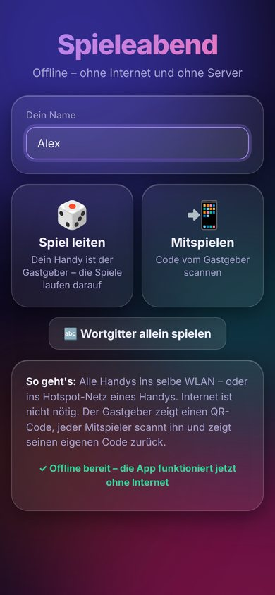
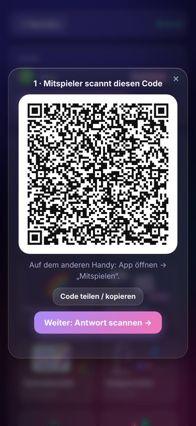
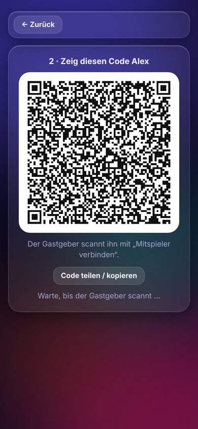
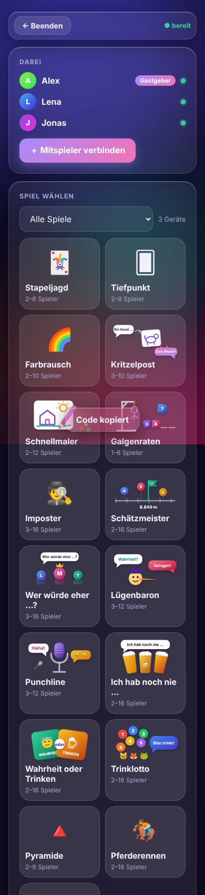

# Spieleabend offline

Alle 18 Spiele vom [Spieleabend](https://github.com/fvh02/HA-Games-Addon) – **ohne Internet, ohne Server,
ohne Home Assistant**. Ein Handy ist der Gastgeber, auf ihm laufen die Spiele. Alle anderen verbinden sich
per **QR-Code** direkt mit ihm.

<p>




</p>

## So spielt ihr

1. **Alle Handys in dasselbe Netz** – ein WLAN ohne Internet reicht, oder der **Hotspot** eines Handys
   (mobile Daten dürfen aus sein). Ganz ohne gemeinsames Netz geht es nicht: Browser dürfen kein
   Bluetooth und kein Wi-Fi Direct benutzen.
2. Einer tippt **„Spiel leiten“**. Sein Handy lädt die Spiele (ein paar Sekunden) und ist der Gastgeber.
3. Gastgeber: **„＋ Mitspieler verbinden“** → ein QR-Code erscheint.
4. Mitspieler: **„Mitspielen“** → den Code scannen → sein Handy zeigt einen Antwort-Code.
5. Gastgeber: **„Weiter: Antwort scannen“** → fertig, der Mitspieler ist dabei. Für jeden Mitspieler einmal.
6. Der Gastgeber wählt ein Spiel – alle Handys wechseln automatisch hinein. Danach geht es wie gewohnt:
   Einstellungen, 📺 Fernseher-Modus, Computer-Spieler usw.

Wer die Verbindung verliert (Handy gesperrt, außer Reichweite), wird kurz von einem Computer-Spieler
vertreten. Einfach den Code des Gastgebers noch einmal scannen – man bekommt seinen Platz zurück.
Geht die Kamera nicht, lassen sich die Codes auch per „Code teilen“ (z. B. AirDrop) übertragen.

**Wichtig:** Das Gastgeber-Handy muss die App die ganze Zeit offen haben (die App hält den Bildschirm wach).
Wird sie geschlossen, endet der Spieleabend.

## Einmalig installieren

Die App muss **einmal mit Internet** geöffnet werden, danach ist alles auf dem Handy gespeichert
(etwa 14 MB, die meisten davon für Python im Browser):

- Adresse: **https://fvh02.github.io/spieleabend-offline/**
- **iPhone:** in Safari öffnen → Teilen → „Zum Home-Bildschirm“. Danach die App **einmal vom
  Home-Bildschirm aus starten**, solange Internet da ist, und warten, bis „✓ Offline bereit“ erscheint.
- **Android:** in Chrome öffnen → ⋮ → „App installieren“, ebenso einmal starten.

Ab dann funktioniert alles im Flugmodus mit WLAN/Hotspot – auf der Hütte, im Zug oder am Strand.

## Technik

- Die Spielregeln sind dieselben Python-Dateien wie im Add-on. Auf dem Gastgeber-Handy laufen sie mit
  [Pyodide](https://pyodide.org) (Python im Browser) in einem Web-Worker (`app/engine-worker.js`,
  `py/offline_hub.py` – die Offline-Version des Servers).
- Die Handys sind über WebRTC-Datenkanäle verbunden (`app/net.js`). Statt eines Servers tragen die
  QR-Codes die Verbindungsdaten (komprimiert, Base45 für kompakte QR-Codes). Es werden keine STUN-
  oder TURN-Server benutzt – nur das lokale Netz.
- Die Spielseiten in `games/` sind die des Add-ons; `games/static/embed.js` leitet ihre Nachrichten an die App.
- `sw.js` speichert alle Dateien für den Offline-Betrieb.

### Spiele aktualisieren

Neue oder geänderte Spiele aus dem Add-on übernehmen:

```sh
git clone https://github.com/fvh02/HA-Games-Addon ../HA-Games-Addon
python3 tools/sync.py ../HA-Games-Addon   # Regeln und Spielseiten übernehmen
python3 tools/build.py                    # Offline-Dateiliste (sw.js) neu erzeugen
```

Neue Spiele zusätzlich in `py/offline_hub.py`, `app/engine-worker.js` (Dateiliste) und `app/app.js`
(Spieleliste) eintragen.

### Veröffentlichen

Bei jedem Push auf `main` veröffentlicht GitHub Actions die App auf GitHub Pages. Einmalig nötig:
**Settings → Pages → Build and deployment → Source: „GitHub Actions“**.

Mitgelieferte Bibliotheken und Lizenzen: [`vendor/LICENSES.md`](vendor/LICENSES.md).
